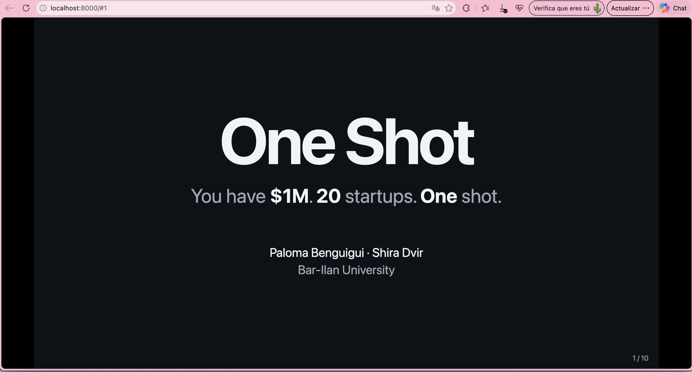
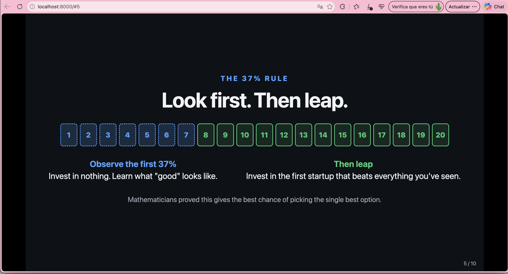
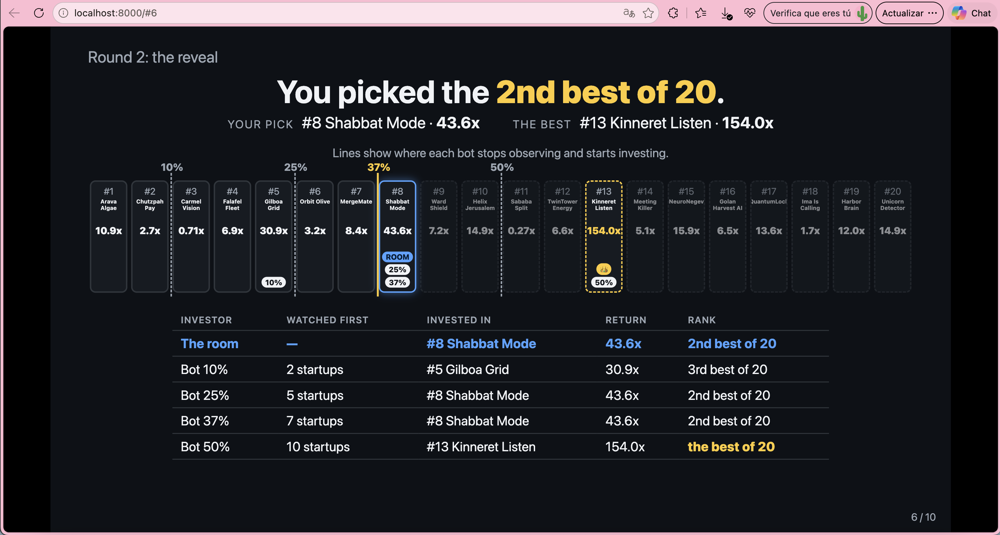
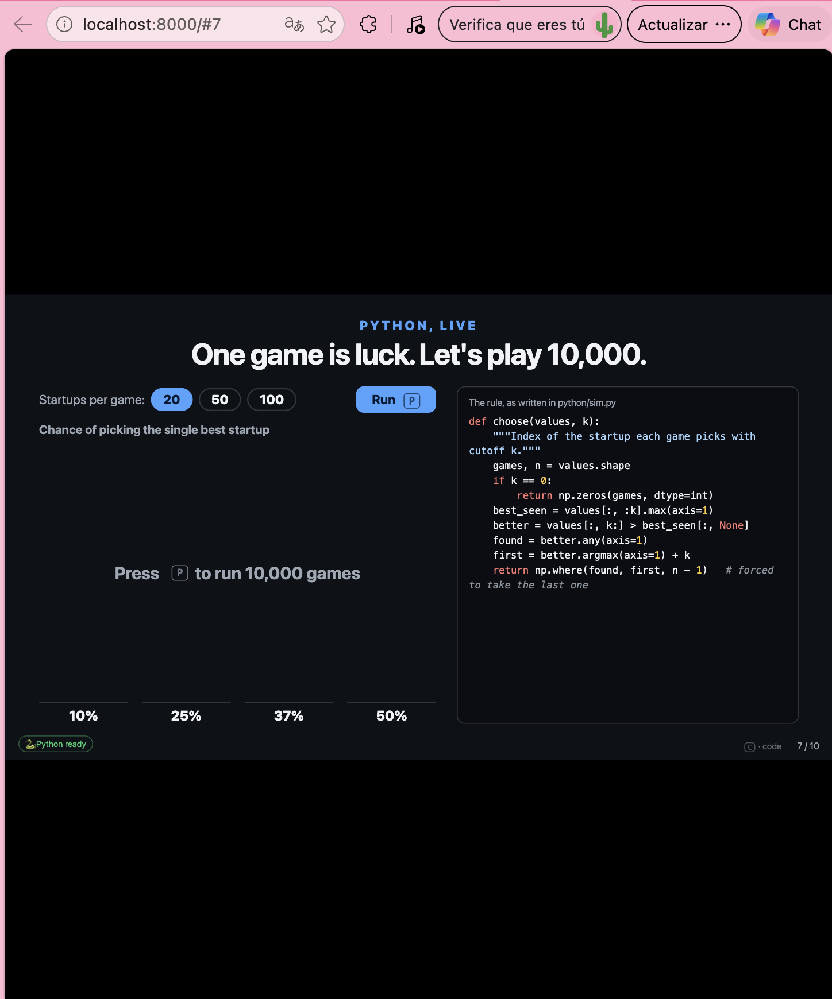
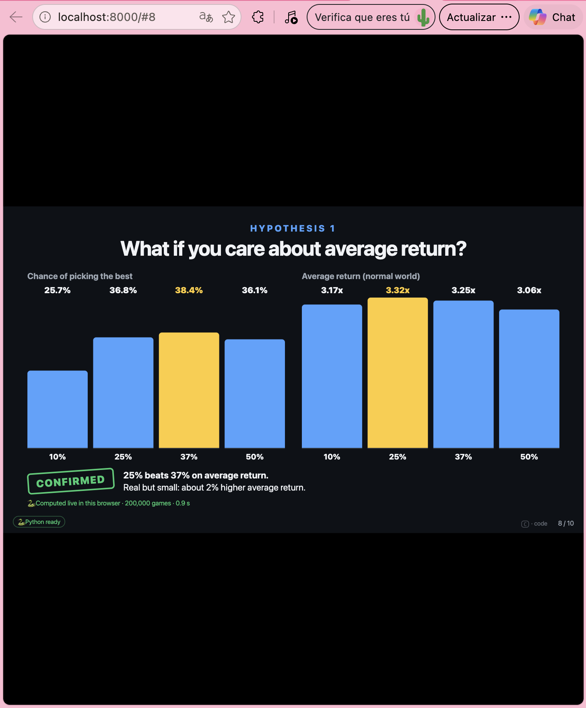
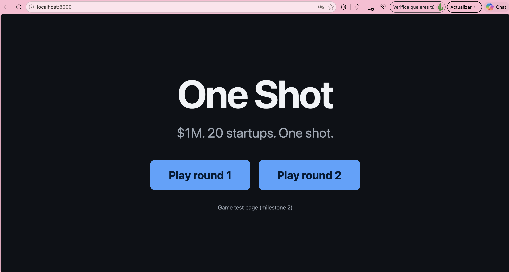
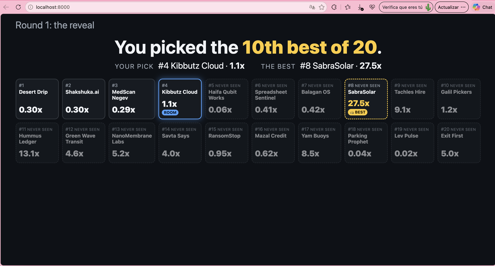
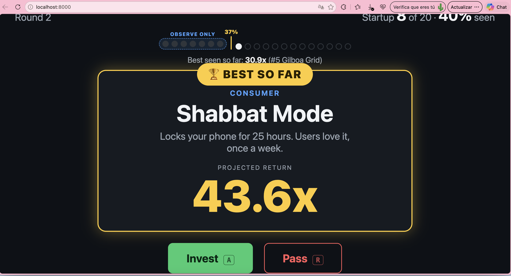

# One Shot

**One Shot** is an interactive classroom experiment about a real management decision: when to stop searching and commit. The audience plays an investor with $1M who must back exactly one of 20 startups. The startups appear one at a time, and a rejected startup is gone forever. The room plays two rounds, the second against four algorithmic investors. Then Python runs live inside the presentation to test the famous 37% rule (from the Secretary Problem), and to check whether the best strategy changes when we change what we measure and what the startup world looks like.

## Status

- ✅ PRD approved
- ✅ Python simulation (`python/sim.py`)
- ✅ Game logic in 2D: two seeded rounds, invest/pass, forced last pick, four bots, reveal
- ✅ Slide shell: 10 slides that fit any screen, keyboard navigation, the game inside slides 3, 4 and 6
- ✅ Live Python with Pyodide on slides 7 to 9: live runs with 20, 50 or 100 startups, a replay of the room's own startups, an automatic fallback to saved results, and a code panel toggled with `C`
- ⏭️ Next: the Three.js scene

## How to run

The presentation is a local web page. It must be opened through a small local server, not by double-clicking `index.html`, because browsers block this kind of JavaScript (and Pyodide) on `file://` pages.

1. In a terminal, go to the project folder and start the server:
   - **Mac:** `python3 -m http.server`
   - **Windows:** `python -m http.server`
2. Open **http://localhost:8000** in Chrome or Edge, and press `F` for fullscreen.

Live Python needs internet the first time: Pyodide (about 15–20 MB) is downloaded from a CDN in the background while slides 1–6 are shown. After that, the browser usually keeps a copy.

### Testing the fallback (no Python)

Open **http://localhost:8000/?offline**

The page then skips Pyodide and uses the saved results in `data/results.json`, exactly as it would if Pyodide failed to load. The pill in the bottom-left corner shows "💾 Saved results". Turning off Wi-Fi is not a reliable test, because the browser may already have a copy of Pyodide.

The fallback also switches on automatically if Pyodide fails, or if it is still not ready 10 seconds after opening slide 7. The hidden `O` key switches to saved results at any time.

To regenerate `data/results.json` outside the browser: `pip install -r requirements.txt`, then `python python/sim.py`.

## Keyboard controls

| Key | Where | What it does |
|---|---|---|
| `→`, `Space`, `Page Down` | All slides | Next slide. On slides 3 and 6 it waits until the room has invested |
| `Shift` + `→` | Slides 3 and 6 | Force the next slide, even if the round is still in progress |
| `←`, `Page Up` | All slides | Previous slide |
| `Home` | All slides | Back to slide 1 |
| `F` | All slides | Fullscreen on/off |
| `A` | Slides 3 and 6 | Invest in the current startup |
| `R` | Slides 3 and 6 | Pass on the current startup (not possible on startup #20) |
| `B` | Slide 6 | Reveal the bots' choices, after the room has invested |
| `P` | Slide 7 | Run the live simulation (10,000 games) |
| `C` | Slides 7, 8 and 9 | Show or hide the Python code (shown on slide 7, hidden on 8 and 9 by default) |
| `Backspace` | Slides 3 and 6 | Hidden: undo the last click only, for presenter mistakes |
| `N` | Slides 3 and 6 | Hidden: restart the current round (for rehearsals) |
| `O` | All slides | Hidden: switch to saved results instead of live Python |

Presentation clickers usually send `Page Up` / `Page Down`, so they work for moving between slides. The startup-count buttons on slide 7 (20 / 50 / 100) are clicked with the mouse.

## Screenshots

### The presentation (milestone 3)

**Slide 1: title.** The cold open, with the authors.

**Slide 5: the 37% rule.** Shown before round 2: observe the first 7 startups, then invest in the first one that beats everything seen so far.

**Slide 6: round 2 reveal with the bots.** All 20 startups in one row, with a line where each bot stops observing. The table compares the room with the four bots on the same startups.

### Live Python (milestone 4)

**Slide 7: Python, live.** Python is loaded and ready (green pill, bottom left). The presenter picks the number of startups per game (20, 50 or 100) and presses `P` to run 10,000 games in the browser. The panel on the right shows the rule exactly as written in `python/sim.py`.

**Slide 8: Hypothesis 1.** The 37% rule finds the single best startup most often, but the 25% strategy earns a slightly higher average return. The label at the bottom confirms the 200,000-game analysis was computed live in the browser. The code panel is hidden here by default (press `C` to show it).

### The game (milestone 2)

**Start menu.** The game test page from milestone 2, with one button per round. It has since been replaced by the slides.

**Round 1 reveal.** All 20 startups are revealed after the room invests. The room's pick is marked ROOM, the best startup is marked BEST, and startups after the pick are marked "never seen." Round 1 shows no percentages, so nothing hints at the 37% rule.

**Round 2 during play.** The counter shows the percentage of startups seen, and the first 7 startups form the "observe only" zone, ending at the 37% line. This startup beats everything seen so far, so it gets the gold BEST SO FAR badge.

## Simulation results

200,000 simulated games per strategy, with the same games used for every strategy and both worlds. Verdicts follow the decision rule in the [PRD](PRD.md): a hypothesis is confirmed if the 95% confidence interval of the mean difference excludes zero in the predicted direction.

| | Hypothesis | Key evidence | Verdict |
|---|---|---|---|
| **H0** | On the chance of picking the single best startup, 37% beats 10%, 25% and 50% | 37% picks the best 38.4% of the time (25%: 36.8%, 50%: 36.1%, 10%: 25.7%). Best cutoff: observe 7 of 20 | ✅ CONFIRMED |
| **H1** | Normal world, average return: 25% beats 37% | 3.32x vs 3.25x, a gap of +0.067x (95% CI +0.063 to +0.071). Best cutoff: observe 5 | ✅ CONFIRMED |
| **H2** | Unicorn world: the best cutoff for average return moves later | Best cutoff moves from 5 to 6. The advantage of 37% over 25% is larger than in the normal world (95% CI of the difference: +0.022 to +0.096) | ✅ CONFIRMED |

**Notes**

- **H1 is real but small in practice.** Deciding at 25% instead of 37% raises the average return by about **2%**. The simulation is large enough to be sure the gap exists, but an investor would barely notice it in a single deal.
- **H2 is also a small shift.** The best cutoff moves by one startup (from 5 to 6). In the unicorn world, 25% and 37% are nearly tied on average return (9.11x vs 9.17x).
- **Observation for H2 (not part of the verdict):** in the unicorn world the average and the typical result point in different directions. Waiting longer raises the *average* return because it catches more jackpots, but the *typical* (median) result is better with 25% (4.11x vs 3.98x). This is a familiar tension in venture capital: a strategy can win on average while the typical outcome gets worse.

## Return models

Returns are measured as multiples: 1x means you get your money back, 3x means you triple it. The simulation uses two "worlds":

| | Normal world | Unicorn world |
|---|---|---|
| Typical (median) startup | 2x | 0.5x |
| Startups that lose money | ~4% | ~65% |
| Startups that return 10x or more | almost none | ~4% |
| Share of all returns from the top 4% | ~10% | ~50% |

- **Normal world:** a steady, mature market. Most startups do okay and nobody does spectacularly.
- **Unicorn world:** venture capital as it usually looks. Most startups lose money, and a rare few produce most of the returns. The numbers were tuned to match the pattern reported in published VC data (for example, Correlation Ventures' analysis of thousands of VC deals).

> **These are illustrative models inspired by VC data, not predictions.** They are simplified on purpose so that the experiment is easy to follow. They do not forecast how any real startup or fund will perform.

### Why lognormal and not Pareto

Both worlds use a **lognormal** curve, with the same shape and a different spread.

- **It fits how startups grow.** Growth compounds (a company doubles, then doubles again), so outcomes multiply. That produces a lopsided curve: you can't lose more than 100%, but the upside has no ceiling.
- **It keeps the experiment clean.** Both worlds have the same shape, so any difference in results comes from one thing only: how unequal the outcomes are.
- **It keeps averages measurable.** A Pareto ("power law") curve is the classic model for VC returns. But to match real VC data, its tail has to be so extreme that the average never settles down, even over 100,000 simulated games, and the 95% confidence intervals in our decision rule would be meaningless. A wide lognormal reproduces the same pattern (most lose, a few win big) while keeping averages stable enough to test.

Screenshots, results and setup instructions will be added when the project is complete.

## Documentation

- [PRD.md](PRD.md): product requirements and plan
- [PROMPTS.md](PROMPTS.md): log of all prompts used to build this project
