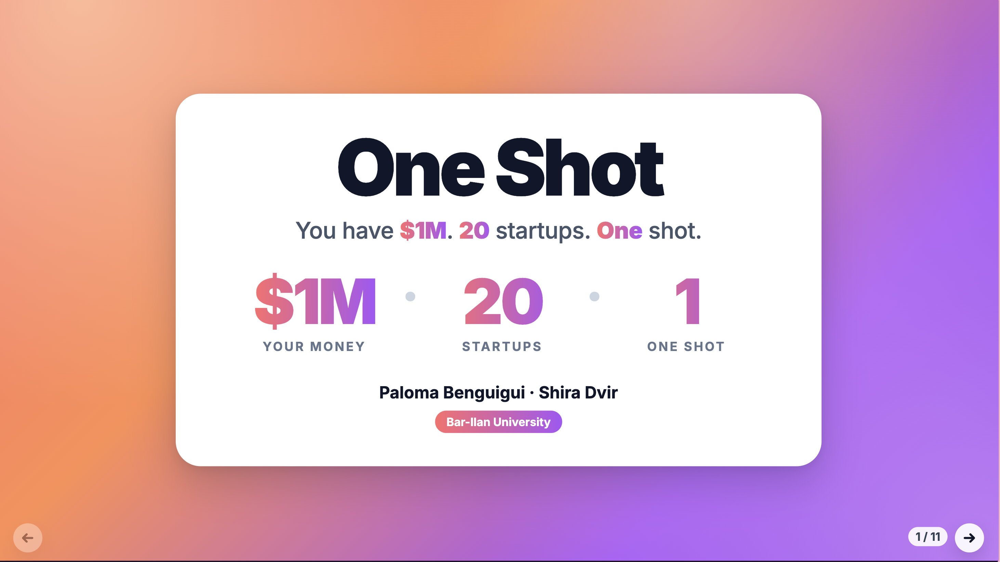
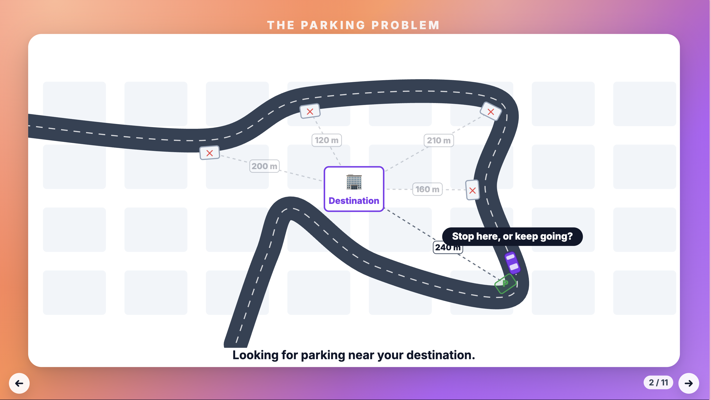
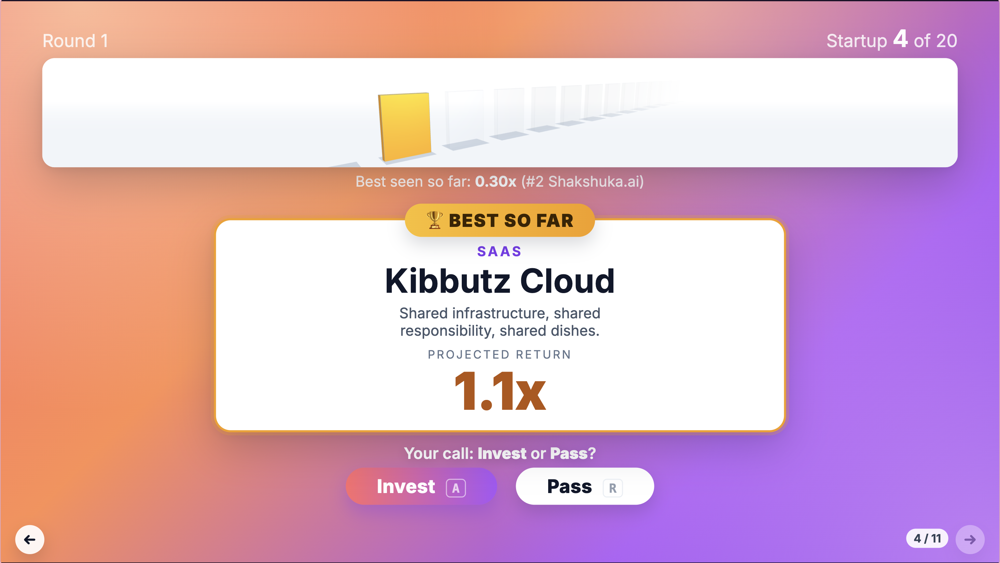
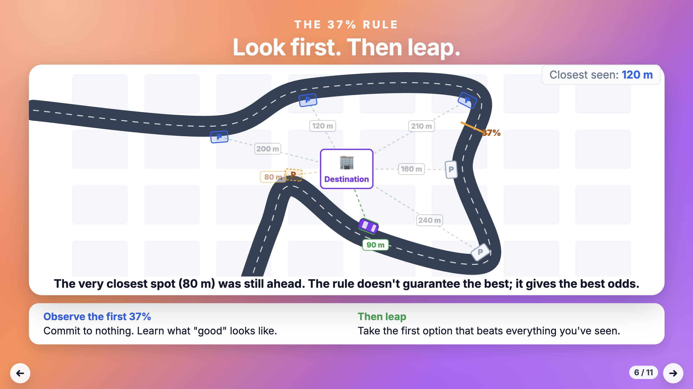
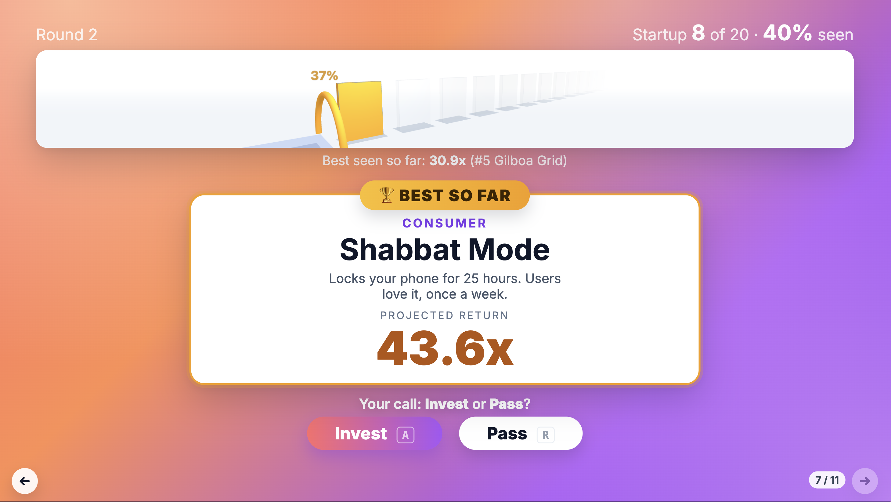
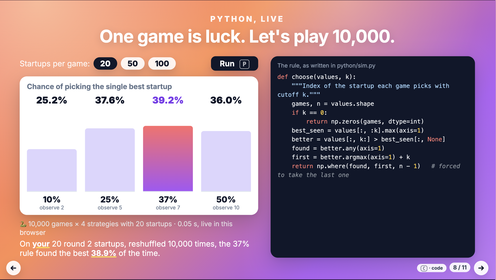
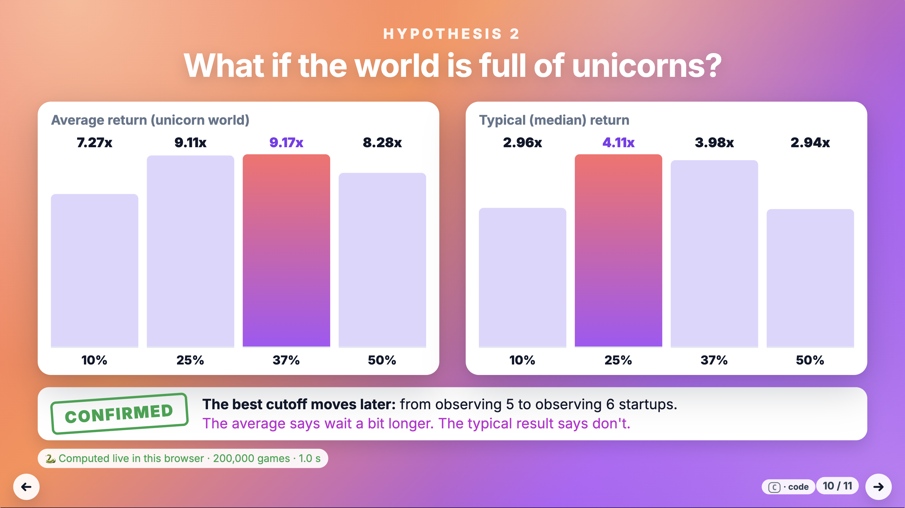
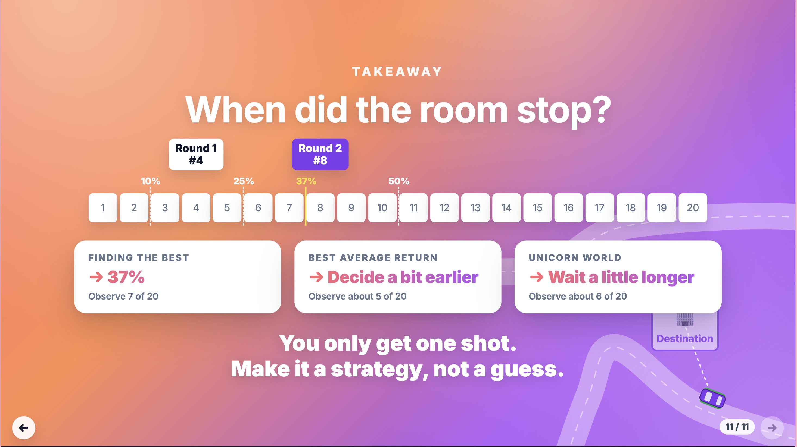

# One Shot

**You have $1M. 20 startups. One shot.**

One Shot is an interactive classroom presentation about a real management decision: **when to stop searching and commit**. The audience plays an investor who must back exactly one of 20 startups. The startups appear one at a time, and a rejected startup is gone forever. The room plays two rounds, the second against four algorithmic investors. Then Python runs live inside the presentation to test the famous **37% rule** (from the Secretary Problem), and to check whether the best strategy changes when we change *what we measure* and *what the startup world looks like*.

By Paloma Benguigui and Shira Dvir, Bar-Ilan University.

## Why this topic

We are Technology Management students, and we follow the startup world closely. Investors, founders and managers face the same problem again and again: opportunities arrive one at a time, waiting has a cost, and a rejected option rarely comes back. That applies to a deal, a hire, a supplier or a product launch window. We wanted to show that **deciding when to stop searching is a real management decision**, not just a math puzzle, and that the "right" rule depends on what a manager is trying to achieve.

## The presentation (11 slides, about 10 minutes)

| # | Slide | What happens |
|---|---|---|
| 1 | Title | $1M · 20 startups · 1 shot |
| 2 | The parking problem | A 2D animation: a car passes free parking spots it can't go back to. "Stop here, or keep going?" No strategy is shown yet |
| 3 | Rules | One at a time, no going back, the last startup is forced, the room votes by show of hands |
| 4 | Round 1 | The live game, with the 3D runway. Pure intuition |
| 5 | Round 1 reveal | All 20 startups, the best one, and the room's pick with its rank |
| 6 | The 37% rule | The same street: observe the first 37% of spots, then park at the first one closer than all you've seen |
| 7 | Round 2 | The room plays again, against four hidden bots (observe 10%, 25%, 37%, 50%) on the same startups |
| 8 | Python, live | 10,000 games run in the browser, with 20, 50 or 100 startups, plus a replay of the room's own startups |
| 9 | Hypothesis 1 | What if you care about average return? |
| 10 | Hypothesis 2 | What if the world is full of unicorns? |
| 11 | Takeaway | When the room stopped, three conclusions, and "You only get one shot. Make it a strategy, not a guess." |

## How to run

The presentation is a local web page. It must be opened through a small local server, not by double-clicking `index.html`, because browsers block this kind of JavaScript (and Pyodide) on `file://` pages. Python 3 is all you need for the server.

1. Open a terminal in the project folder and start the server:
   - **Mac:** `python3 -m http.server`
   - **Windows:** `python -m http.server`
2. Open **http://localhost:8000** in Chrome or Edge.
3. Press `F` for fullscreen.

**Internet:** live Python needs internet the first time. Pyodide (about 15–20 MB) downloads from a CDN in the background while slides 1–7 are shown, and the browser usually keeps a copy afterwards. Everything else (the game, the 3D scene, the font) is stored in the repo and works offline.

**After editing files:** if the browser shows an old version, press `Cmd + Shift + R` (Mac) or `Ctrl + Shift + R` (Windows) to force a full reload.

### Offline fallback

Open **http://localhost:8000/?offline**

The page skips Pyodide and uses the saved results in `data/results.json`, exactly as it would if Pyodide failed to load. Slides 8 to 10 then show a "💾 Saved results" label instead of "🐍 Live". Turning off Wi-Fi is not a reliable test, because the browser may already have a copy of Pyodide.

The fallback also switches on automatically if Pyodide fails, or if it is still not ready 10 seconds after opening slide 8. The hidden `O` key switches to saved results at any time.

### Regenerating the saved results

```
pip install -r requirements.txt
python python/sim.py
```

This prints the results and rewrites `data/results.json`. On a Mac, use `pip3` and `python3`.

## Keyboard controls

| Key | Where | What it does |
|---|---|---|
| `→`, `Space`, `Page Down` | All slides | Next slide. On slides 4 and 7 it waits until the room has invested |
| `Shift` + `→` | Slides 4 and 7 | Force the next slide, even if the round is still in progress |
| `←`, `Page Up` | All slides | Previous slide |
| `Home` | All slides | Back to slide 1 |
| `F` | All slides | Fullscreen on/off |
| `A` | Slides 4 and 7 | Invest in the current startup |
| `R` | Slides 4 and 7 | Pass on the current startup (not possible on startup #20) |
| `B` | Slide 7 | Reveal the bots' choices, after the room has invested |
| `P` | Slides 2 and 6 | Replay the parking-street animation |
| `P` | Slide 8 | Run the live simulation (10,000 games) |
| `C` | Slides 8, 9 and 10 | Show or hide the Python code (shown on slide 8, hidden on 9 and 10 by default) |
| `Backspace` | Slides 4 and 7 | Hidden: undo the last click only, for presenter mistakes |
| `N` | Slides 4 and 7 | Hidden: restart the current round (for rehearsals) |
| `O` | All slides | Hidden: switch to saved results instead of live Python |

Every slide also has small ← and → arrow buttons in the bottom corners. The → arrow is disabled during a round, like the → key. Presentation clickers usually send `Page Up` / `Page Down`, so they work for moving between slides. The startup-count buttons on slide 8 (20 / 50 / 100) are clicked with the mouse.

The room's choices are saved in the browser tab, so an accidental reload keeps them. To start a rehearsal from scratch, press `N` on slides 4 and 7, or open the page in a new tab.

## How it works

### Python: the simulation

- **`python/sim.py`** is the single source of truth for the math. It simulates the four "observe, then leap" strategies (and every possible cutoff from 0 to 19) on 200,000 games, in two return "worlds", and tests the hypotheses with a pre-set decision rule. It only needs numpy.
- **Same file, two places:**
  - **On a laptop:** `python python/sim.py` produces `data/results.json`, the offline fallback.
  - **In the browser:** **Pyodide** (Python compiled to WebAssembly, version 314.0.7, pinned) loads the same `sim.py` and runs it **inside the presentation**.
- **Background worker:** Pyodide runs in a background thread (a Web Worker), so the slides stay smooth while it downloads and computes. As soon as it's ready, it recomputes the full 200,000-game analysis live (about 1 second). The result matches `results.json` exactly.
- **Slide 8:** runs 10,000 new games on demand, with 20, 50 or 100 startups, and replays the room's own round 2 startups.
- **Code on screen:** the code panels on slides 8–10 are cut from the real `sim.py` when the page loads, so the code on screen is the code that runs.

### JavaScript: the game and the slides

| File | What it does |
|---|---|
| `js/slides.js` | The 11 slides: content, navigation, keyboard, arrow buttons, and scaling every slide from a fixed 1920×1080 design to fit any screen (no scrolling) |
| `js/game.js` | Game rules only: builds a round from its seed, invest/pass, the forced last pick, the four bots (same rule as `sim.py`), ranks |
| `js/ui.js` | The game's screens: the startup card, the "best so far" badge, the reveals, the bots table. Saves the room's choices in the browser tab |
| `js/rng.js` | A seeded random generator, so both rounds show the same startups in every rehearsal and in the live show |
| `js/startups.js` | 40 fictional startups inspired by the Israeli tech scene (any resemblance to real companies is unintended) |
| `js/street.js` | The 2D parking-street animations (slides 2 and 6) and the parked car on slide 11, in plain SVG |
| `js/python.js`, `js/pyworker.js` | Loading Pyodide in the background, the automatic fallback, and calling `sim.py` |
| `js/charts.js` | Simple bar charts and code panels in plain HTML |
| `css/style.css` | The design: sunset gradient, floating white cards, Inter font |

### Three.js: the 3D runway

`js/scene3d.js` draws one animated Three.js scene above the startup card during rounds 1 and 2:
- **Startup tiles:** 20 tiles run along a runway into the distance. The current startup's tile rises into a spotlight (violet, or amber when it's the best so far). Passed tiles tip backward and sink: gone forever. The chosen tile lifts and spins.
- **Last startup:** a red wall appears behind startup #20.
- **Round 2:** the first 7 slots sit on a blue "observe only" floor, followed by a gold 37% arch that flashes when the room passes it.
- **Performance:** the scene draws only while something is moving and never blocks a key press.
- **Safety net:** if a computer can't run 3D (no WebGL), simple progress dots appear instead.

Three.js 0.187 is stored in `vendor/three/`, so 3D works offline.

### Project structure

```
index.html            the presentation
css/style.css         design
js/                   slides, game, 3D runway, street animation, Pyodide bridge
python/sim.py         the simulation
data/results.json     saved results (offline fallback)
vendor/three/         Three.js 0.187 (MIT license)
vendor/fonts/         Inter font (SIL Open Font License)
screenshots/          README images
design-options/       the three color mockups we considered for the design
PRD.md                product requirements and plan
PROMPTS.md            log of every prompt used to build the project
```

## Hypotheses and results

The famous rule is the starting point, not the conclusion. We wrote down three hypotheses **before** running the simulation, and a rule for judging them: a hypothesis is **confirmed** if the 95% confidence interval of the mean difference excludes zero in the predicted direction, **rejected** if it excludes zero in the opposite direction, and **inconclusive** otherwise. The median is reported as an observation only.

200,000 simulated games per strategy, with the same games used for every strategy and both worlds:

| | Hypothesis | Key evidence | Verdict |
|---|---|---|---|
| **H0** | On the chance of picking the single best startup, 37% beats 10%, 25% and 50% | 37% picks the best 38.4% of the time (25%: 36.8%, 50%: 36.1%, 10%: 25.7%). Best cutoff: observe 7 of 20 | ✅ CONFIRMED |
| **H1** | Normal world, average return: 25% beats 37% | 3.32x vs 3.25x, a gap of +0.067x (95% CI +0.063 to +0.071). Best cutoff: observe 5 | ✅ CONFIRMED, small in practice |
| **H2** | Unicorn world: the best cutoff for average return moves later | Best cutoff moves from 5 to 6. The advantage of 37% over 25% is larger than in the normal world (95% CI of the difference: +0.022 to +0.096) | ✅ CONFIRMED, small shift |

**Notes**

- **H1 is real but small in practice.** Deciding at 25% instead of 37% raises the average return by about **2%**. The simulation is large enough to be sure the gap exists, but an investor would barely notice it in a single deal.
- **H2 is also a small shift.** The best cutoff moves by one startup (from 5 to 6). In the unicorn world, 25% and 37% are nearly tied on average return (9.11x vs 9.17x).
- **Observation for H2 (not part of the verdict):** in the unicorn world, the average and the typical result point in different directions. Waiting longer raises the *average* return because it catches more jackpots, but the *typical* (median) result is better with 25% (4.11x vs 3.98x). A strategy can win on average while the typical outcome gets worse, a familiar tension in venture capital.
- **More startups:** on slide 8, the 37% strategy still finds the best most often with 50 and 100 startups (about 37% of the time).

**Conclusion:** the 37% rule is the right answer to "how do I find *the* best?" If you care about average return, decide a bit earlier; in a unicorn world, on average, wait a little longer. There is no universal stopping rule: first define what success means.

### Return models

Returns are measured as multiples: 1x means you get your money back, 3x means you triple it. The simulation uses two "worlds":

| | Normal world | Unicorn world |
|---|---|---|
| Typical (median) startup | 2x | 0.5x |
| Startups that lose money | ~4% | ~65% |
| Startups that return 10x or more | almost none | ~4% |
| Share of all returns from the top 4% | ~10% | ~50% |

- **Normal world:** a steady, mature market. Most startups do okay and nobody does spectacularly.
- **Unicorn world:** venture capital as it usually looks. Most startups lose money, and a rare few produce most of the returns. The numbers were tuned to match the pattern reported in published VC data (for example, Correlation Ventures' analysis of thousands of VC deals). The live game uses this world.

> **These are illustrative models inspired by VC data, not predictions.** They are simplified on purpose so the experiment is easy to follow. They do not forecast how any real startup or fund will perform.

**Why lognormal and not Pareto.** Both worlds use a lognormal curve, with the same shape and a different spread.
- **It fits how startups grow:** growth compounds, so outcomes multiply. You can't lose more than 100%, but the upside has no ceiling.
- **It keeps the experiment clean:** both worlds have the same shape, so any difference in results comes from one thing only, how unequal the outcomes are.
- **It keeps averages measurable:** a Pareto ("power law") curve is the classic model for VC returns. But to match real VC data, its tail has to be so extreme that the average never settles down, even over 100,000 games, and our 95% confidence intervals would be meaningless. A wide lognormal reproduces the same pattern (most lose, a few win big) while keeping averages stable enough to test.

## Screenshots

Fullscreen screenshots of the final design.

**Slide 1: title.** One floating white card on the sunset gradient: the title, the hook line, three big numbers ($1M · 20 · 1) and the authors.



**Slide 2: the parking problem.** A 2D animation before round 1. A car drives a winding road around the destination; each free spot appears with a dashed line and its distance, so the audience sees distances go up and down. At each spot: "Stop here, or keep going?" The car never parks and can't go back. No mention of the 37% rule, so round 1 stays pure intuition.



**Slide 4: round 1.** The animated Three.js runway above the startup card: the current startup's tile rises into the spotlight (amber when it is the best so far), passed tiles sink away, and future ones fade into the distance. The room votes by show of hands; "Your call: Invest or Pass?" sits above the buttons, and the next arrow stays disabled until the room invests. Round 1 shows no percentages.



**Slide 6: the 37% rule, on the same street.** The first 3 of 8 spots are blue ("observe only"). After the gold 37% line, the car parks at the first spot closer than every spot it has seen (90 m), and then shows that an even closer spot (80 m) was still ahead: the rule gives the best odds, not a guarantee.



**Slide 7: round 2.** The runway now shows the blue "observe only" floor and the gold 37% arch, and the counter shows the share of startups seen (here 40%, just past the arch). Four hidden bots play the same startups and are revealed after the room decides.



**Slide 8: Python, live.** After pressing `P`, Python runs 10,000 games in the browser (Pyodide) and shows how often each strategy picks the single best startup. It also replays the room's own round 2 startups, reshuffled 10,000 times. On the right, the rule exactly as written in `python/sim.py`.



**Slide 10: Hypothesis 2.** In the unicorn world the best cutoff for average return moves later (from observing 5 to 6 startups): confirmed. The typical (median) result points the other way, shown as an observation. The label confirms the 200,000-game analysis was computed live in the browser.



**Slide 11: takeaway.** When the room stopped in rounds 1 and 2, three conclusion cards, the closing line, and the parking street in the background with the car finally parked.



## How we worked with AI

We built One Shot with an AI coding agent (Claude Code, running Claude Opus 5.5). We made the decisions; the agent proposed, wrote code, and ran checks. How we worked:

- **Plan first.** Before any code, we asked the agent to evaluate the idea critically (is it original? what are the weak spots?), then to write a [PRD](PRD.md). We reviewed it, asked for changes (scope cut to about 4 hours, Windows instructions, extra deliverables) and only then approved it.
- **Milestones, one push each.** We built in milestones: simulation → 2D game → slide shell → live Python → 3D scene → parking slides → design → final docs. Before each milestone the agent showed a plan and waited for our OK. After each one we committed and pushed, so the GitHub history shows the progress step by step.
- **We tested every step ourselves.** After each milestone we ran the presentation in the browser (in fullscreen), checked it, took the screenshots, and asked for fixes before moving on. The agent also checked layouts and the live Python with an automated browser.
- **Hypotheses before results.** We required that the two "twists" be treated as hypotheses, with a decision rule written before the simulation ran, and that the slides show whatever the data said.
- **We corrected the agent when needed.** For example:
  - **The H2 decision rule:** when trimming the PRD, the agent added an extra rule we had not asked for ("if mean and median disagree, the verdict is inconclusive"), which made H2 come out inconclusive. We noticed, asked where the rule came from, and had the original rule applied. H2 became confirmed, and the mean-vs-median tension was kept as an observation.
  - **"Small in practice":** H1 was statistically confirmed, but we asked for a clear note that the effect is only about 2%.
  - **3D is mandatory:** the first PRD treated the Three.js scene as optional if time ran short. The course requires it, so we had the PRD and plan changed to make it mandatory.
  - **Wording accuracy:** we added "on average" to the unicorn-world conclusion, so the slide does not overstate the result.
- **The agent also caught problems.** For example, it pointed out that a straight street toward the destination would make later parking spots always closer, which breaks the rule, and proposed the winding road. It also found that the browser was showing cached old files during a test.
- **Every prompt is logged.** [PROMPTS.md](PROMPTS.md) contains every prompt we sent from the start of the project, with a timestamp and a one-line summary of what the agent did. Logging started with our third message; the two earlier ones were a command to check the AI model and a question about which folder we were in.

## Time spent

Estimated from the timestamps in [PROMPTS.md](PROMPTS.md). Each timestamp is when the agent finished a response, so the real sessions started a little earlier.

| Session | Time | What we did |
|---|---|---|
| Wed 4 Nov, afternoon | ~10 min | Set up the prompt log |
| Wed 4 Nov, evening | ~2.5 h | Idea evaluation, PRD, GitHub repo, simulation (milestone 1), 2D game (milestone 2), slide shell (milestone 3) |
| Sat 7 Nov, night | ~45 min | Live Python with Pyodide (milestone 4), 3D runway (milestone 5) |
| Sun 8 Nov, morning | ~2 h | Parking slides, the new design, final README |
| **Total** | **about 5 to 5.5 hours** | |

The PRD planned about 4 hours. The extra hour or so came from additions beyond the original plan: the parking-problem slides and the full redesign.

## Credits

- [Three.js](https://threejs.org) (MIT license): 3D runway
- [Pyodide](https://pyodide.org) (MPL 2.0) and [numpy](https://numpy.org) (BSD): Python in the browser
- [Inter](https://rsms.me/inter/) by Rasmus Andersson (SIL Open Font License 1.1): font
- All startups are fictional.

## Documentation

- [PRD.md](PRD.md): product requirements and plan
- [PROMPTS.md](PROMPTS.md): log of every prompt used to build the project
